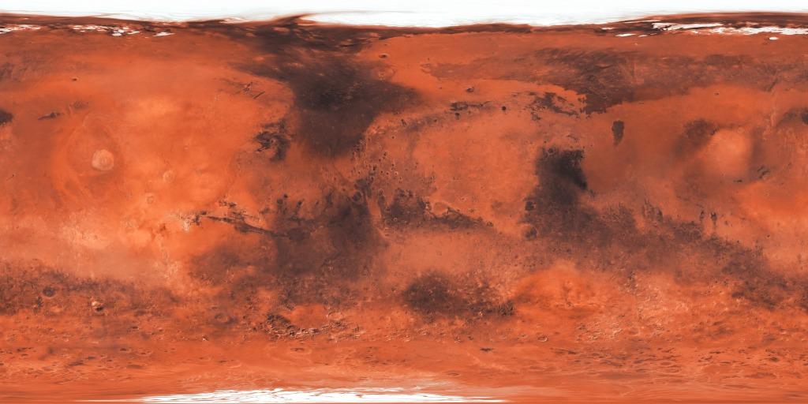

# Galactic Museum Game — AFTERLIGHT: Mars Rover & Ingenuity Helicopter 🚀

An educational, interactive 3D space exploration simulation built with **Three.js / WebGL** and ready for drop-in integration with **React** websites for museums, schools, and STEM learning centers.



---

## 🌟 Highlights & Game Modes

### 1. 🔴 Mars Rover Exploration (Sojourner / Perseverance class)
* **6-Wheel Rocker-Bogie Suspension**: Realistic suspension adapting over boulders, craters, and dune ridges without springs.
* **Solar Overdrive Sprint**: High-discharge capacitor burst to power through loose sand drifts.
* **Laser Spectrometer (APXS)**: Scan Martian rocks and unlock authentic NASA educational science debriefs.
* **Dynamic Dust Physics & Audio**: Procedural dust plumes, wheel tracks, and real-time audio synthesis (chassis rumble, motor whine, scanner pulse, wind ambience).
* **Dual Celestial Bodies**: Explore both **Mars (Ares Vallis)** and the **Moon (Mare Tranquillitatis)** with authentic gravity and visual styling.

### 2. 🚁 Ingenuity — Flight Operations Mode
* **NASA Ingenuity Mars Helicopter**: Detailed 3D model featuring counter-rotating carbon-fiber rotor blades, solar mast, gold thermal foil fuselage, nav-cam, and high-stability landing legs.
* **Full 6-DOF Aerodynamic Physics**: Responsive vertical lift, forward/reverse tilt, banking, yaw rotation, smooth momentum, and auto-hover stabilization (`X` key).
* **Cargo Transport & Deployment Mechanic**: Hover over equipment depots at the Mars Research Outpost, engage electromagnetic cargo lock (`E` key), navigate crosswinds, and deploy scientific containers to marked drop zones.
* **Flight Avionics HUD & Minimap**: Real-time altitude, horizontal/vertical speed, compass bearing, rotor RPM telemetry, and radar beacon tracking.
* **4 Progressive Educational Missions**: From first takeoff and hovering to terrain reconnaissance and multi-payload outpost logistics.

### 3. 📱 Full Mobile & Touch Optimization
* Ergonomic on-screen virtual joysticks (drive/lift, turn/strafe).
* Action clusters (Sprint, Brake, Scan, Camera Switch, Stabilize, Cargo Pick/Drop).
* Responsive layout adapting seamlessly to portrait and landscape phone orientations with zero overlap.

---

## 🎮 Controls

### 🚜 Rover Controls
| Action | Keyboard | Touch / Mobile |
| :--- | :--- | :--- |
| **Drive / Reverse** | `W` / `S` or `↑` / `↓` | Left Joystick (Vertical) |
| **Steer Left / Right** | `A` / `D` or `←` / `→` | Left Joystick (Horizontal) |
| **Solar Overdrive (Sprint)** | `Shift` | `SPRINT` Button |
| **Brake** | `Space` | `BRAKE` Button |
| **Inspect / Laser Scan** | `E` | `SCAN` Button |
| **Switch Camera** | `C` | `CAM` Button |
| **Reset Vehicle** | `R` | `RESET` Button |
| **Mute / Audio** | `M` | Top Status Bar Icon |

### 🚁 Helicopter Controls
| Action | Keyboard | Touch / Mobile |
| :--- | :--- | :--- |
| **Ascend / Descend** | `Space` / `Ctrl` | Altitude Buttons / Right Joystick |
| **Move Forward / Backward** | `W` / `S` | Left Joystick (Pitch) |
| **Bank Left / Right** | `A` / `D` | Left Joystick (Roll) |
| **Yaw Rotate** | `Q` / `E` | Turn Left / Right |
| **Cargo Attach / Release** | `E` | `CARGO` Button |
| **Auto-Hover / Stabilize** | `X` | `HOVER` Button |
| **Forward Boost** | `Shift` | `BOOST` Button |
| **Switch Camera Mode** | `C` | `CAM` Button (Chase / Orbit / Top-Down) |

---

## 🚀 How to Run Locally

### Option A: Direct Web Browser (Zero Build Step)
1. Open terminal in the project root:
   ```bash
   python -m http.server 8080
   ```
   *(or `npx serve .`)*
2. Navigate in any browser to:
   ```
   http://localhost:8080/index.html
   ```

---

## ⚛️ React Integration Guide

A complete, production-ready React component is included in [`/react`](./react).

### Installation
```bash
npm install three
```

### Usage
```jsx
import React, { useState } from 'react';
import MarsRoverGame from './react/MarsRoverGame';

export default function MuseumExhibit() {
  const [score, setScore] = useState(0);

  return (
    <div style={{ width: '100vw', height: '100vh' }}>
      <MarsRoverGame
        initialWorld="mars"
        soundEnabled={true}
        volume={0.6}
        assetBasePath="/assets"
        onMissionComplete={(data) => {
          console.log('Mission Cleared:', data);
          setScore((s) => s + data.score);
        }}
        onFactDiscovered={(fact) => {
          console.log('Fact unlocked:', fact.title, fact.text);
        }}
      />
    </div>
  );
}
```

See [`react/README.md`](./react/README.md) for full prop documentation, event hooks, and styling options.

---

## 📂 Project Structure

```
├── index.html              # Standalone web game (Rover & Helicopter modes)
├── assets/                 # High-resolution PBR textures and Mars surface maps
│   └── textures/
│       ├── mars_surface.jpg
│       ├── mars_rock.webp
│       ├── moon_surface.avif
│       └── moon_rock.jpg
├── css/                    # Modular stylesheet for HUD, UI, and mobile controls
├── js/                     # Modular game logic, physics engine, and audio synthesis
├── react/                  # Drop-in React component (<MarsRoverGame />)
│   ├── MarsRoverGame.jsx
│   ├── MarsRoverGame.css
│   ├── index.js
│   └── README.md
└── package.json            # NPM scripts and dependencies
```

---

## 🔬 Educational Objectives
Designed for NASA museum kiosks and young explorers:
- **Orbital & Planetary Science**: Atmospheric density differences between Earth and Mars (1% Earth atmosphere, requiring 2,400+ RPM rotor speeds).
- **Robotics Engineering**: Rocker-bogie kinematics, center-of-mass balancing, and autonomous obstacle navigation.
- **Surface Geology**: Identification of volcanic basalt, hematite spherules ("Martian blueberries"), and crater impact ejecta.

---

## 📄 License
MIT License. Created for STEM education and interactive museum exhibits.
